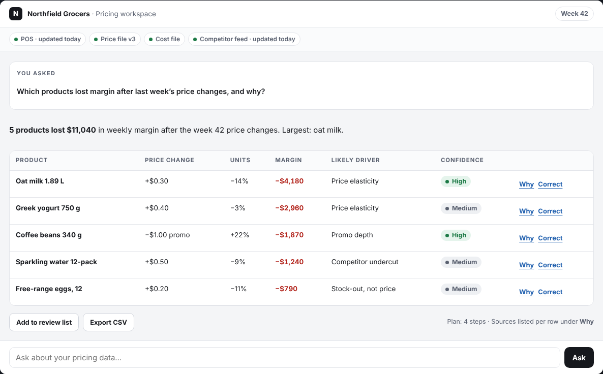
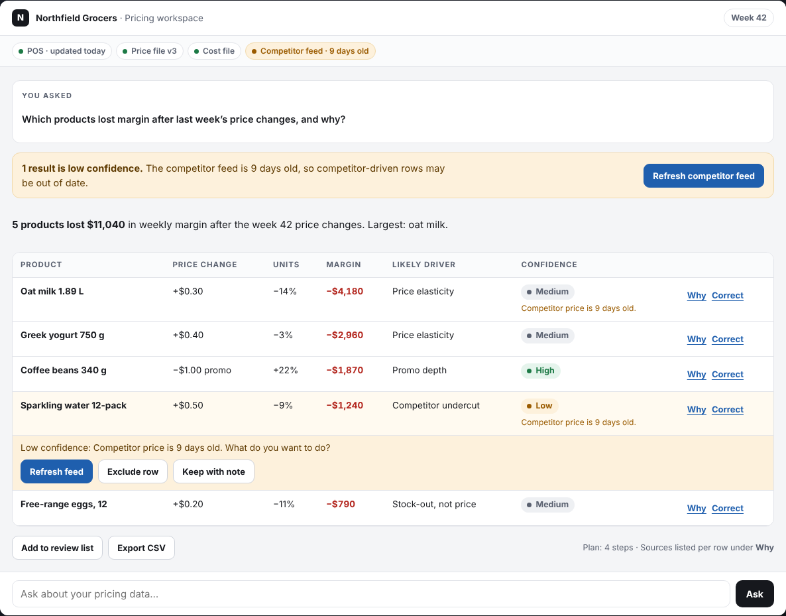
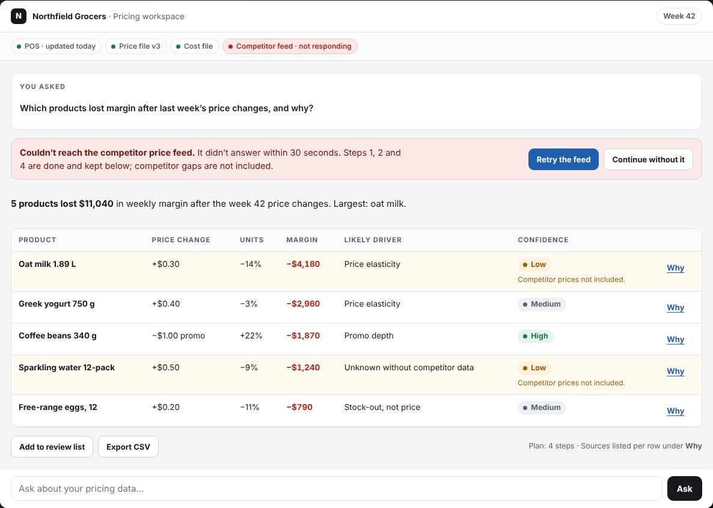
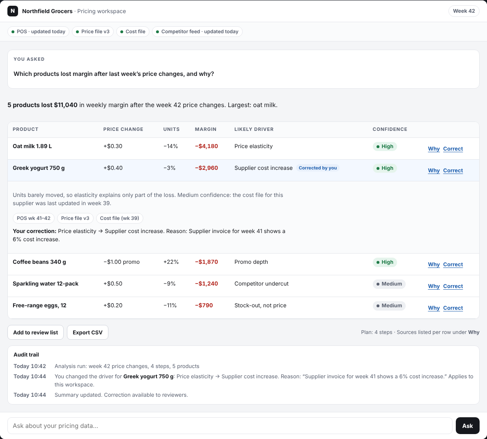

# AI Pricing Assistant: interaction-state prototype

A working prototype of the six states an AI feature needs inside an enterprise analytics product, shown through a retail pricing assistant.

**Live demo:** [danielrilleyportfolio.netlify.app/pricing-assistant](https://danielrilleyportfolio.netlify.app/pricing-assistant)
**Case study:** decisions, decision log and design rules on the same page.



## Why this exists

Most AI features are designed for the happy path. A pricing analyst needs more before acting on a number: when to trust a result, what happens when a data source fails, and how their corrections are kept. This prototype designs all six states first, then builds them.

## The six states

| State | What the user sees | Rule the interface keeps |
|---|---|---|
| 1. Ready | Starter tasks from the user's workspace, and the data the assistant can and can't see | Never open on a blank prompt |
| 2. Working | A four-step plan with each data source, and a Stop button | Show the plan; stopping keeps finished steps |
| 3. Result | A table with margin impact, likely driver, per-row confidence and sources | Return work the user can check and edit |
| 4. Low confidence | Rows affected by stale competitor prices are flagged, with refresh, exclude or keep-with-note | Flag it, say why, offer a choice |
| 5. Error | The competitor feed times out; finished steps are kept, with retry or continue-without | Explain in plain words, keep the work, offer recovery |
| 6. Corrected | The user changes a driver and gives a reason; it is logged with its scope | Record what changed, why and where it applies |

| Low confidence | Error | Corrected |
|---|---|---|
|  |  |  |

## Design decisions

1. **Confidence per row, not per answer.** One overall score hides the weak row. Analysts act row by row.
2. **The plan is part of the answer.** When a number looks wrong, the first question is which data it came from.
3. **Failures keep the user's work.** A failed source ends one step, not the whole analysis.
4. **Corrections need a reason and a scope.** An unexplained edit can't be reviewed or learned from.

## Run it

No build step and no dependencies. Open `index.html` in a browser, or serve the folder:

```
python3 -m http.server 8000
```

Then visit `http://localhost:8000`.

## Files

- `index.html`: the page and the prototype markup
- `demo.js`: state model, rendering and interactions (vanilla JavaScript, no network calls)
- `demo.css`: the prototype's product UI
- `page.css`: the page around it

## Accessibility

Keyboard-operable tabs (arrow keys, Home, End), visible focus, a polite live region that announces state changes, reduced-motion support, and a stacked card layout on small screens.

## How AI was used

I defined the states, the decisions and the interaction rules, and directed the build. An AI coding assistant (Claude) wrote most of the code to that spec.

## Data

Northfield Grocers, its products and every number are fictional. No client data and no former employer's work is used.

## Status

A concept, not yet tested with users. Next: short sessions with pricing analysts on whether per-row confidence changes what they act on.

## License

MIT. See [LICENSE](LICENSE).
